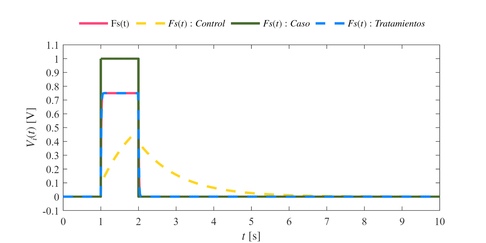
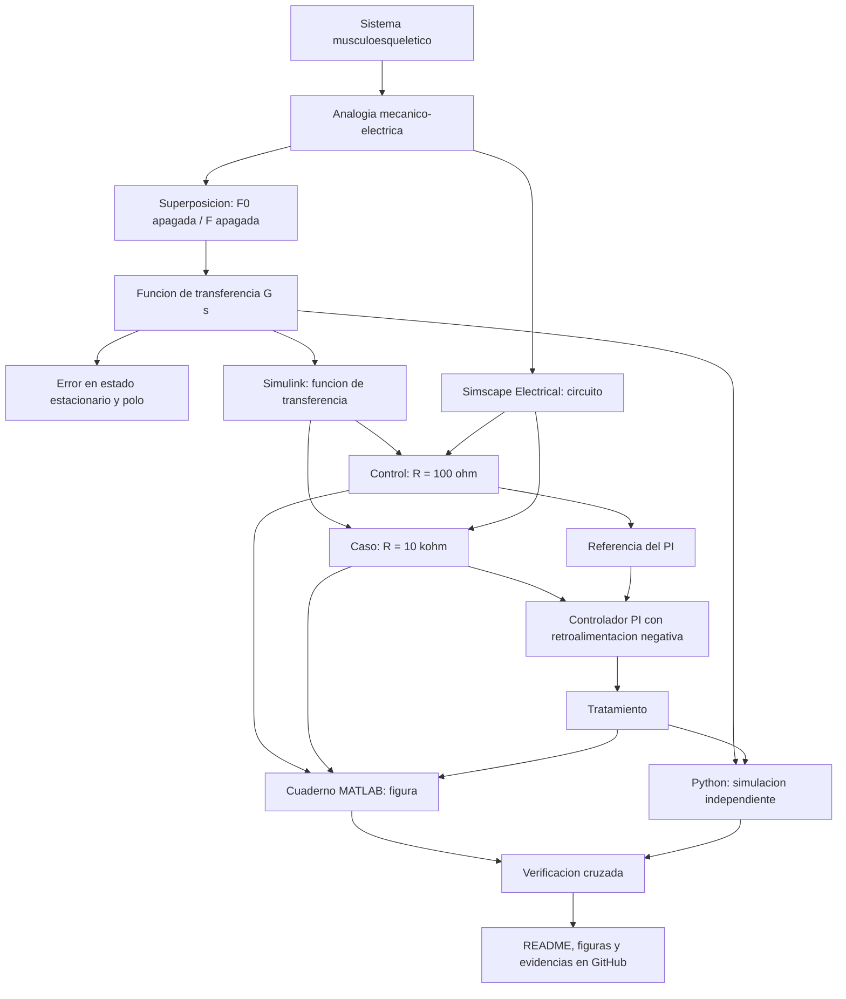

# Práctica 3 — Modelado y control del sistema musculoesquelético

Repositorio académico de la asignatura **Modelado de Sistemas Fisiológicos**, correspondiente al programa de **Ingeniería Biomédica** del Tecnológico Nacional de México / Instituto Tecnológico de Tijuana. Esta práctica integra analogía mecánico–eléctrica, análisis matemático por superposición, análisis de error y estabilidad, simulación en MATLAB/Simulink/Simscape, diseño de un controlador PI y reproducción independiente en Python.

El caso de estudio representa un sistema musculoesquelético mediante un **circuito eléctrico de primer orden con dos fuentes** (la fuerza aplicada $F(t)$ y una fuente proporcional $F_0(t)=\alpha F(t)$). Se comparan tres condiciones: **Control** (resistencia $R=100\,\Omega$), **Caso** (resistencia elevada $R=10\,\mathrm{k}\Omega$) y **Tratamiento** (el Caso regulado por un controlador con retroalimentación negativa que toma como referencia la respuesta del Control).

**Docente:** Dr. Paul Antonio Valle Trujillo  
**Correo:** paul.valle@tectijuana.edu.mx  
**Departamento:** Ingeniería Eléctrica y Electrónica  
**Institución:** Tecnológico Nacional de México / Instituto Tecnológico de Tijuana  
**Asignatura:** Modelado de Sistemas Fisiológicos  
**Programa:** Ingeniería Biomédica  
**Estudiante:** Obregon Maldonado Alan Yahir · 23212221 · l23212221@tectijuana.edu.mx

**Repositorio de la asignatura:** https://github.com/DrPaulValle/MSF-IBF1020  
**Sede:** Blvd. Alberto Limón Padilla s/n, Tijuana, C. P. 22454, B. C., México.

---

<a id="contenido"></a>
## Contenido

1. [Resumen](#resumen)
2. [Competencia y objetivos](#objetivos)
3. [Relación con el temario](#temario)
4. [Modelo físico y analogía eléctrica](#analogia)
5. [Formulación matemática](#modelo)
6. [Análisis temporal y de estabilidad](#analisis)
7. [Señal de entrada y condiciones de simulación](#senales)
8. [Implementación en MATLAB, Simulink y Simscape](#matlab)
9. [Control en lazo cerrado (PI)](#pid)
10. [Reproducción en Python](#python)
11. [Resultados y verificación cruzada](#resultados)
12. [Flujo de trabajo](#flujo)
13. [Actividades del estudiante](#actividades)
14. [Estructura del repositorio](#estructura)
15. [Requisitos](#requisitos)
16. [Reproducibilidad y entregables](#reproducibilidad)
17. [Referencias](#referencias)

---

<a id="resumen"></a>
## Resumen

La práctica tiene como propósito **modelar, analizar, simular y controlar** un sistema musculoesquelético simplificado, representado por una resistencia $R$ y dos capacitancias, $C_p$ y $C_s$, alimentadas por dos fuentes de voltaje. Debido a que el circuito contiene dos fuentes, el análisis se realiza mediante el **principio de superposición**: se obtiene la contribución de $F(t)$ con $F_0(t)$ apagada y la de $F_0(t)$ con $F(t)$ apagada. La suma de ambas conduce a la función de transferencia de primer orden

$$
G(s)=\frac{F_s(s)}{F(s)}=\frac{RC_s s+1-\alpha}{R(C_p+C_s)s+1}.
$$

Con ella se calculan el **error en estado estacionario** ante un pulso/escalón ($e_{ss}=\alpha$) y la **estabilidad en lazo abierto** (un único polo real negativo). Se simulan las condiciones *Control* y *Caso* con dos representaciones equivalentes en Simulink (circuito en Simscape Electrical y función de transferencia) y se diseña un **controlador PI** con retroalimentación negativa unitaria, de modo que la respuesta del *Caso* ("Tratamiento") siga a la del *Control*. Los resultados se generan desde un cuaderno MATLAB (`.mlx`) y se reproducen con un script en Python.

**Palabras clave:** sistema musculoesquelético; analogía mecánico–eléctrica; superposición; función de transferencia; controlador PI; MATLAB; Simulink; Simscape Electrical; Python; simulación *in silico*.

[Volver al contenido](#contenido)

---

<a id="objetivos"></a>
## Competencia y objetivos

### Competencia a desarrollar

Comprender los conceptos básicos de Ingeniería de Control, la respuesta temporal y los criterios de estabilidad mediante el modelado, la simulación y el control de un sistema fisiológico equivalente a un circuito eléctrico, empleando herramientas computacionales para su análisis y documentación.

### Objetivo general

Modelar el sistema musculoesquelético mediante una analogía eléctrica, obtener su función de transferencia por superposición, simularlo en condiciones *Control* y *Caso*, y diseñar un controlador con retroalimentación que lleve la respuesta del *Caso* a la del *Control*, verificando los resultados con dos herramientas computacionales.

### Objetivos específicos

- Transformar el sistema mecánico en su circuito eléctrico equivalente e identificar entradas, salida y elementos.
- Aplicar superposición para obtener $F_{s1}(s)$ (con $F_0$ apagada) y $F_{s2}(s)$ (con $F$ apagada).
- Obtener la función de transferencia total $F_s(s)/F(s)$.
- Calcular el error en estado estacionario y analizar la estabilidad en lazo abierto mediante el polo del sistema.
- Simular las condiciones *Control* y *Caso* con el circuito de Simscape Electrical y con la función de transferencia en Simulink.
- Implementar un controlador PI con retroalimentación negativa y registrar sus ganancias.
- Reproducir las respuestas en MATLAB y en Python y comparar ambas.
- Documentar el procedimiento y los resultados en un repositorio de GitHub.

[Volver al contenido](#contenido)

---

<a id="temario"></a>
## Relación con el temario

| Unidad | Área | Contenidos aplicados |
|---|---|---|
| I | Sistemas de control retroalimentados | Lazo abierto y cerrado, diagramas de bloques, respuesta ante un pulso, error en estado estacionario y estabilidad |
| II | Modelado matemático | Analogía mecánico–eléctrica, superposición, leyes de Kirchhoff, función de transferencia |
| III | Controladores | Controlador PI/PID y sintonización de ganancias |

[Volver al contenido](#contenido)

---

<a id="analogia"></a>
## Modelo físico y analogía eléctrica

El sistema se representa con un circuito con una resistencia $R$ y dos capacitores, $C_s$ y $C_p$, y dos fuentes: la entrada $F(t)$ y la fuente $F_0(t)$, proporcional a la entrada mediante el factor $\alpha$:

$$
F_0(t)=\alpha F(t).
$$

En el análisis manuscrito se definen la corriente total $x(t)$, que se divide en una rama con $C_s$ ($x_1$) y otra con $R$ y $F_0$ ($x_2$), y que circula por $C_p$ hacia la salida $F_s(t)$.

| Símbolo | Equivalente eléctrico | Valor |
|---|---|---|
| $F(t)$ | Voltaje de entrada | Pulso de $1\,\mathrm{V}$, $1\le t<2\,\mathrm{s}$ |
| $F_0(t)=\alpha F(t)$ | Segunda fuente de voltaje | $\alpha=0.25$ |
| $F_s(t)$ | Voltaje de salida | — |
| $R$ | Resistencia | $100\,\Omega$ (*Control*); $10\,\mathrm{k}\Omega$ (*Caso*) |
| $C_s$ | Capacitancia | $10\,\mu\mathrm{F}$ |
| $C_p$ | Capacitancia | $100\,\mu\mathrm{F}$ |

> **Interpretación fisiológica:** la correspondencia exacta de cada elemento ($R$, $C_s$, $C_p$, $\alpha$) con una estructura musculoesquelética concreta debe tomarse del instructivo de la práctica. Los archivos disponibles definen la estructura matemática y los valores numéricos, pero no detallan esa asignación; complétese en esta sección con la interpretación de la asignatura.

En el modelo de Simscape, cada capacitor incluye una resistencia en serie parásita de $1\,\mu\Omega$ (`r = 1e-6`), valor numérico auxiliar que no forma parte del modelo analítico.

[Volver al contenido](#contenido)

---

<a id="modelo"></a>
## Formulación matemática

El desarrollo completo (a mano) está en [`Análisis_matemático_P3.pdf`](Análisis_matemático_P3.pdf). A continuación se resume.

### 1. Superposición — Circuito 1 (se apaga $F_0$)

Con $x(t)=x_1(t)+x_2(t)$:

$$
x(t)=C_p\frac{dF_{s1}}{dt},\qquad
x_1(t)=C_s\frac{d\,[F(t)-F_{s1}(t)]}{dt},\qquad
x_2(t)=\frac{F(t)-F_{s1}(t)}{R}.
$$

Sustituyendo y aplicando Laplace con condiciones iniciales nulas:

$$
C_p s F_{s1}=C_s s\,[F-F_{s1}]+\frac{F-F_{s1}}{R}
\;\Rightarrow\;
\boxed{F_{s1}(s)=\frac{RC_s s+1}{R(C_p+C_s)s+1}\,F(s).}
$$

### 2. Superposición — Circuito 2 (se apaga $F$)

Con $C_p$ y $C_s$ en paralelo ($C_p+C_s$) y la fuente $-F_0(t)=-\alpha F(t)$:

$$
-\alpha F(t)=R\,x(t)+\frac{1}{C_p+C_s}\int x(t)\,dt,
\qquad
F_{s2}(t)=\frac{1}{C_p+C_s}\int x(t)\,dt,
$$

$$
\boxed{F_{s2}(s)=-\frac{\alpha}{R(C_p+C_s)s+1}\,F(s).}
$$

### 3. Función de transferencia total

$$
F_s(s)=F_{s1}(s)+F_{s2}(s)
\;\Rightarrow\;
\boxed{G(s)=\frac{F_s(s)}{F(s)}=\frac{RC_s s+1-\alpha}{R(C_p+C_s)s+1}.}
$$

Su ecuación diferencial equivalente es

$$
R(C_p+C_s)\frac{dF_s}{dt}+F_s=RC_s\frac{dF}{dt}+(1-\alpha)F.
$$

[Volver al contenido](#contenido)

---

<a id="analisis"></a>
## Análisis temporal y de estabilidad

### 1. Error en estado estacionario

Para una entrada escalón unitario, $F(s)=1/s$:

$$
e_{ss}=\lim_{s\to0}sF(s)\left[1-G(s)\right]=1-(1-\alpha)=\boxed{\alpha=0.25.}
$$

Es decir, la ganancia en continua del sistema es $G(0)=1-\alpha=0.75$ y la salida en lazo abierto **no** alcanza a la entrada: queda un error de $0.25\,\mathrm{V}$ para $F=1\,\mathrm{V}$. Con $\alpha=0.25$ es lo que se observa en la meseta de $0.75\,\mathrm{V}$ de la respuesta del *Control*.

### 2. Polo y estabilidad

El denominador $R(C_p+C_s)s+1=0$ da un único polo real:

$$
\boxed{\lambda=-\frac{1}{R(C_p+C_s)}<0\;\Rightarrow\;\text{sistema estable.}}
$$

Con los valores de la práctica (cálculo propio, verificable con el código):

| Condición | $R$ | $\tau=R(C_p+C_s)$ | Polo $\lambda$ | Cero $-\dfrac{1-\alpha}{RC_s}$ | $G(0)$ |
|---|---:|---:|---:|---:|---:|
| Control | $100\,\Omega$ | $11\,\mathrm{ms}$ | $-90.9\,\mathrm{s^{-1}}$ | $-750\,\mathrm{s^{-1}}$ | $0.75$ |
| Caso | $10\,\mathrm{k}\Omega$ | $1.1\,\mathrm{s}$ | $-0.909\,\mathrm{s^{-1}}$ | $-7.5\,\mathrm{s^{-1}}$ | $0.75$ |

El *Control* responde casi instantáneamente ($\tau=11\,\mathrm{ms}$), mientras que el *Caso* es unas 100 veces más lento ($\tau=1.1\,\mathrm{s}$); ese retardo es el comportamiento que el controlador debe corregir.

### 3. Verificación mínima en MATLAB

```matlab
alpha = 0.25; Cs = 10e-6; Cp = 100e-6;
for R = [100 10e3]
    G = tf([R*Cs, 1-alpha],[R*(Cp+Cs), 1]);
    fprintf('R = %g: polo = %g, cero = %g, G(0) = %g\n', ...
            R, pole(G), zero(G), dcgain(G));
end
```

[Volver al contenido](#contenido)

---

<a id="senales"></a>
## Señal de entrada y condiciones de simulación

| Parámetro | Valor |
|---|---|
| Intervalo | $0\le t\le10\,\mathrm{s}$ |
| Solver (cuaderno) | `ode15s` |
| Paso máximo (cuaderno) | $10^{-3}\,\mathrm{s}$ |
| Entrada $F(t)$ | Pulso de amplitud $1\,\mathrm{V}$, retardo $1\,\mathrm{s}$, duración $1\,\mathrm{s}$ ($1\le t<2\,\mathrm{s}$), periodo $10\,\mathrm{s}$ |
| Factor $\alpha$ | $0.25$ |

La entrada se genera en Simulink con un bloque *Discrete Pulse Generator* (periodo $10$, ancho de pulso $10\,\%$, retardo $1$). En Python se construye el mismo pulso con `u[round(1/dt):round(2/dt)] = 1`.

> El paso máximo guardado en el modelo `sistema.slx` es $10^{-2}\,\mathrm{s}$; al simular desde el cuaderno, el parámetro `MaxStep = 1E-3` lo sustituye.

[Volver al contenido](#contenido)

---

<a id="matlab"></a>
## Implementación en MATLAB, Simulink y Simscape

El modelo [`sistema.slx`](sistema.slx) contiene dos subsistemas, **Control** y **Caso**, que difieren en el valor de $R$. Cada uno se implementa de dos formas equivalentes:

| Implementación | Descripción | Salida al *Workspace* |
|---|---|---|
| Circuito, Simscape Electrical (**CE**) | Dos fuentes de voltaje controladas, $R$, $C_s$, $C_p$ y ganancia $\alpha=0.25$ | — |
| Función de transferencia (**FT**) | $G(s)=\dfrac{RC_s s+1-\alpha}{R(C_p+C_s)s+1}$ | — |

Variables enviadas al *Workspace* con *To Workspace*:

| Variable | Significado |
|---|---|
| `F` | Entrada $F(t)$ |
| `Fsx` | Salida $F_s(t)$ de la condición **Control** |
| `Fsy` | Salida $F_s(t)$ de la condición **Caso** |
| `PID` | Salida $F_s(t)$ del **Tratamiento** (Caso con controlador) |

### Ejecución desde el cuaderno MATLAB

El cuaderno [`obregon23212221.mlx`](obregon23212221.mlx) configura la simulación y genera la figura:

```matlab
tend = '10';
file = 'sistema';
open_system(file)
parameters.StopTime = tend;
parameters.Solver   = 'ode15s';
parameters.MaxStep  = '1E-3';

x = sim(file,parameters);
signal = 'Individual';
plotSignals(x.t,x.F,x.Fsx,x.Fsy,x.PID,signal)
```

La función local `plotSignals` grafica las cuatro señales y exporta el archivo `Individual_matlab.pdf` en formato vectorial.

[Volver al contenido](#contenido)

---

<a id="pid"></a>
## Control en lazo cerrado (PI)

### 1. Estructura

El *Tratamiento* es la planta del **Caso** ($R=10\,\mathrm{k}\Omega$) en lazo cerrado con retroalimentación negativa unitaria. La **referencia** es la respuesta del *Control* y la señal realimentada es la salida del *Caso*:

$$
e(t)=F_{s,\mathrm{Control}}(t)-F_{s,\mathrm{Tratamiento}}(t),
$$

$$
K(s)=k_P+\frac{k_I}{s}+k_Ds,\qquad
T(s)=\frac{K(s)G_{\mathrm{Caso}}(s)}{1+K(s)G_{\mathrm{Caso}}(s)}.
$$

### 2. Ganancias registradas

| Fuente | Tipo | $k_P$ | $k_I$ | $k_D$ |
|---|---|---:|---:|---:|
| Simulink (`sistema.slx`) | PI, filtro $N=100$ | $0$ | $180\,297.5219$ | $0$ |
| Python (script) | PI | $0.013239$ | $68\,547.1067$ | $0$ |

> **Nota:** las ganancias del script de Python no coinciden con las del bloque PID guardado en el modelo de Simulink. Ambos conjuntos siguen a la referencia (ver resultados), pero para una comparación estricta MATLAB–Python conviene usar **el mismo** conjunto en las dos herramientas, tal como pide la verificación cruzada.

### 3. Verificación de seguimiento (cálculo propio)

Simulando $T(s)$ con la referencia del *Control* ante el pulso, se obtiene el siguiente error máximo de seguimiento (la referencia alcanza $0.75\,\mathrm{V}$):

| Ganancias | Polos de lazo cerrado ($\mathrm{s^{-1}}$) | Error máximo $\lvert e\rvert_{\max}$ |
|---|---|---:|
| Simulink ($k_P=0$, $k_I=180\,297.52$) | $-16\,384,\ -7.50$ | $\approx 0.007\,\mathrm{V}$ |
| Python ($k_P=0.013239$, $k_I=68\,547.11$) | $-6\,217,\ -7.51$ | $\approx 0.019\,\mathrm{V}$ |

El polo lento de lazo cerrado ($\approx-7.5$) casi coincide con el cero de la planta del *Caso* ($-7.5$), por lo que prácticamente se cancela y la respuesta queda dominada por el polo rápido.

[Volver al contenido](#contenido)

---

<a id="python"></a>
## Reproducción en Python

El script [`obregon23212221.py`](obregon23212221.py) usa `numpy`, `control` y `matplotlib`. Sus apartados son:

1. **Datos generales:** vector temporal ($0$–$10\,\mathrm{s}$, $\Delta t=10^{-3}\,\mathrm{s}$) y pulso de entrada entre $1$ y $2\,\mathrm{s}$.
2. **Componentes del circuito:** $R=100\,\Omega$, $C_s=10\,\mu\mathrm{F}$, $C_p=100\,\mu\mathrm{F}$, $\alpha=0.25$ y $R_{\mathrm{caso}}=10\,\mathrm{k}\Omega$.
3. **Funciones de transferencia:** `sys` (Control), `sysCaso` (Caso) y `sysT` (planta del Tratamiento).
4. **Controlador:** `PID = tf([kD,kP,kI],[1,0])` con $k_P=0.013239$, $k_I=68\,547.1067$, $k_D=0$.
5. **Lazo cerrado:** `feedback(series(PID,sysT),1,sign=-1)`.
6. **Respuestas forzadas:** `forced_response` para Control, Caso y Tratamiento (con la respuesta del Control como referencia).
7. **Figura:** se guarda como `practica3_python.pdf`.

Para ejecutarlo:

```bash
pip install numpy control matplotlib
python obregon23212221.py
```

[Volver al contenido](#contenido)

---

<a id="resultados"></a>
## Resultados y verificación cruzada

### Figura de MATLAB



Archivos de resultados generados por el código:

| Herramienta | Archivo |
|---|---|
| MATLAB/Simulink | [`Individual_matlab.pdf`](Individual_matlab.pdf) |
| Python | [`practica3_python.pdf`](practica3_python.pdf) |

### Lectura de la figura

- **Entrada $F(t)$:** pulso de $1\,\mathrm{V}$ entre $1$ y $2\,\mathrm{s}$.
- **Control:** responde casi de inmediato y se estabiliza en $0.75\,\mathrm{V}$ ($=1-\alpha$), como predice el análisis.
- **Caso:** crece lentamente ($\tau=1.1\,\mathrm{s}$), alcanza $\approx0.48\,\mathrm{V}$ al terminar el pulso y decae después.
- **Tratamiento (PI):** reproduce la meseta de $0.75\,\mathrm{V}$ del *Control*, por lo que el controlador compensa la lentitud del *Caso*.

> **Nota sobre la leyenda en MATLAB:** en la función `plotSignals` las curvas se trazan en el orden `Fsx` (Control), `Fsy` (Caso), `F` (entrada), `PID` (Tratamiento), pero la leyenda se declara en el orden *Fs(t)*, *Control*, *Caso*, *Tratamientos*. Por ello, en la figura exportada los nombres no corresponden con las curvas (la curva amarilla discontinua, lenta, es el *Caso*; la verde es la entrada; la rosa es el *Control*). Se recomienda corregir la leyenda a `legend('Fs(t): Control','Fs(t): Caso','F(t)','Fs(t): Tratamiento')` antes de entregar. En Python, la entrada es rosa, el *Control* amarillo, el *Caso* verde discontinuo y el *Tratamiento* azul punteado.

### Aspectos para discutir

- Coincidencia entre el circuito (Simscape) y la función de transferencia (Simulink).
- Efecto de $R$ sobre la rapidez de la respuesta: $\tau=11\,\mathrm{ms}$ frente a $1.1\,\mathrm{s}$.
- Error en estado estacionario $e_{ss}=\alpha$ y su efecto en la meseta de $0.75\,\mathrm{V}$.
- Seguimiento de la referencia con el PI y diferencia entre las ganancias de Simulink y de Python.
- Consistencia entre las figuras de MATLAB y Python.
- Limitaciones de la analogía fisiológica.

**Resultados del estudiante:** agregar en la versión final la figura de Python generada, la captura del bloque PID con las ganancias empleadas y un comentario interpretativo propio.

[Volver al contenido](#contenido)

---

<a id="flujo"></a>
## Flujo de trabajo



[Volver al contenido](#contenido)

---

<a id="actividades"></a>
## Actividades del estudiante

### Etapa 1. Formulación y análisis

- [x] Transformar el sistema mecánico en circuito eléctrico.
- [x] Aplicar superposición (circuitos 1 y 2).
- [x] Obtener la función de transferencia total.
- [x] Calcular el error en estado estacionario.
- [x] Analizar la estabilidad en lazo abierto.

### Etapa 2. Simulación

- [x] Implementar el circuito en Simscape Electrical (Control y Caso).
- [x] Implementar la función de transferencia en Simulink (Control y Caso).
- [x] Configurar el pulso de entrada y las variables de salida al *Workspace*.

### Etapa 3. Control y reproducción

- [x] Implementar el controlador PI con retroalimentación negativa.
- [x] Ejecutar el cuaderno MATLAB y generar la figura.
- [x] Reproducir las respuestas en Python.
- [ ] Unificar las ganancias entre Simulink y Python.
- [ ] Corregir la leyenda de la figura de MATLAB.

### Etapa 4. Documentación

- [ ] Agregar la figura de Python y la captura del bloque PID.
- [ ] Redactar la interpretación propia de los resultados.
- [ ] Publicar los archivos y un `CITATION.cff`.

[Volver al contenido](#contenido)

---

<a id="estructura"></a>
## Estructura del repositorio

```text
.
├── README.md                        # Reporte y guía de reproducción
├── CITATION.cff                     # Datos de citación (por agregar)
├── Análisis_matemático_P3.pdf       # Desarrollo analítico manuscrito
├── obregon23212221.mlx              # Cuaderno MATLAB
├── sistema.slx                      # Modelo Simulink/Simscape
├── obregon23212221.py               # Implementación en Python
├── Individual_matlab.pdf            # Figura exportada desde MATLAB
├── Individual_matlab.png            # Vista previa para el README
└── practica3_python.pdf             # Figura exportada desde Python
```

**Criterio de nombres:** los archivos conservan los nombres de las fuentes entregadas; las figuras `Individual_matlab.pdf` y `practica3_python.pdf` son los nombres que generan el cuaderno y el script. Si se reorganizan en subcarpetas, actualizar las rutas del README.

[Volver al contenido](#contenido)

---

<a id="requisitos"></a>
## Requisitos

- **MATLAB** y **Simulink**.
- **Simscape Electrical** (circuito del modelo).
- **Control System Toolbox** (`tf`, `pole`, `zero`, `dcgain`) y herramientas de Simulink para el bloque *PID Controller*.
- **Python 3** con `numpy`, `control` y `matplotlib`.
- **Git y GitHub** para el repositorio.

Las versiones mínimas no están especificadas en los archivos de la práctica.

[Volver al contenido](#contenido)

---

<a id="reproducibilidad"></a>
## Reproducibilidad y entregables

### Secuencia de reproducción

1. Descargar los archivos de la práctica en una misma carpeta (el cuaderno busca `sistema.slx` en la ruta actual).
2. Abrir `obregon23212221.mlx` y ejecutarlo: simula `sistema.slx` con `ode15s`, paso máximo $10^{-3}\,\mathrm{s}$ y $t_{end}=10\,\mathrm{s}$.
3. Verificar que se genera `Individual_matlab.pdf`.
4. Instalar las dependencias de Python y ejecutar `obregon23212221.py`; verificar que se genera `practica3_python.pdf`.
5. Comparar ambas figuras con las mismas entradas y parámetros.
6. Completar este README con las evidencias propias.

### Resultados mínimos esperados

| Entregable | Evidencia |
|---|---|
| Análisis matemático | Superposición, función de transferencia, error y estabilidad (`Análisis_matemático_P3.pdf`) |
| Simulación | `sistema.slx` con Control, Caso y Tratamiento |
| MATLAB | Cuaderno `.mlx` y figura `Individual_matlab.pdf` |
| Python | Script `.py` y figura `practica3_python.pdf` |
| Documentación | `README.md`, `CITATION.cff` e interpretación de resultados |

### Criterios de presentación académica

Debe distinguirse entre **resultados de referencia reproducidos** y **aportaciones propias**. La ejecución de scripts y la generación de figuras no sustituyen la discusión del comportamiento fisiológico, matemático y eléctrico del sistema.

[Volver al contenido](#contenido)

---

<a id="referencias"></a>
## Referencias

[1] M. C. Khoo, *Physiological Control Systems: Analysis, Simulation, and Estimation*, 2nd ed., IEEE Press, 2018.

[2] F. C. Hoppensteadt y C. S. Peskin, *Modeling and Simulation in Medicine and the Life Sciences*, Springer.

[3] J. E. Hall, *Guyton and Hall Textbook of Medical Physiology*, 14th ed., Elsevier, 2021.

[4] K. Ogata, *Ingeniería de Control Moderna*, 5.ª ed., Pearson Educación, 2010.

[5] N. S. Nise, *Control Systems Engineering*, 8th ed., John Wiley & Sons, 2020.

[6] P. A. Valle, *Syllabus para Modelado de Sistemas Fisiológicos*, Tecnológico Nacional de México / Instituto Tecnológico de Tijuana, Tijuana, B. C., México, 2026. Disponible en: https://biomath.xyz/course/

[7] Tecnológico Nacional de México, *Programa de estudio de la asignatura Modelado de Sistemas Fisiológicos, IBF-1020*.

---

## Uso académico

Este repositorio se utiliza como evidencia de la **Práctica 3** de **Modelado de Sistemas Fisiológicos**. Su finalidad es desarrollar habilidades de modelado, simulación, control y documentación técnica; cualquier cambio de parámetros, estructura del controlador o procedimiento debe identificarse y justificarse.
